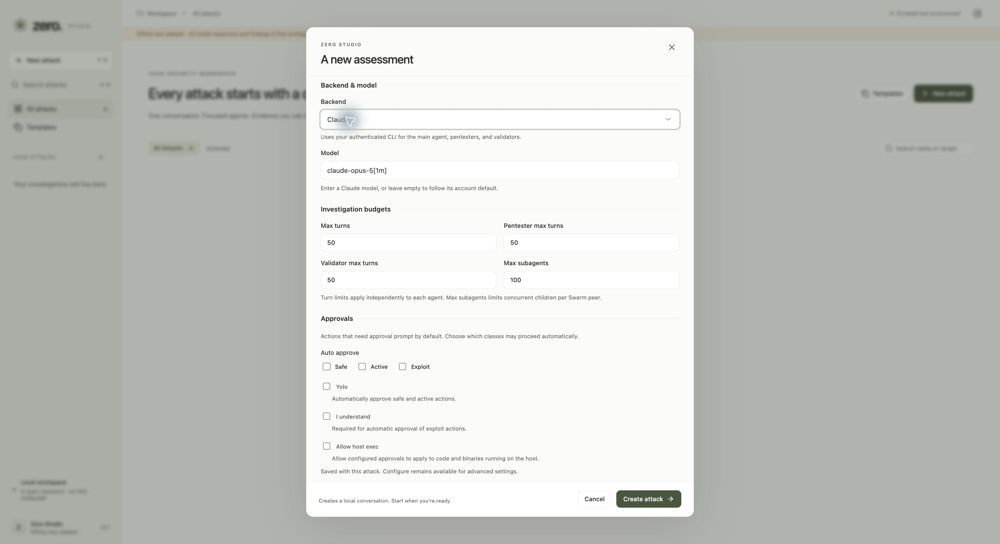
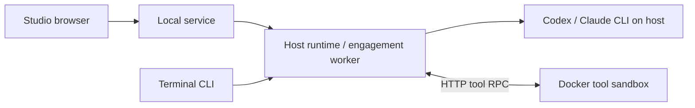

# Zero

Zero is an autonomous, multi-agent system for authorized web application pentesting and
bug-bounty research. It coordinates investigations, independently validates candidate findings,
and saves evidence and reports in a local workspace.

Use **Zero Studio**, the browser interface, to manage assessments and review results, or use the
independent [command-line interface](CLI.md) from your terminal. Both use the same core runtime
and your authenticated Codex or Claude CLI.

> [!CAUTION]
> Test only systems you own or have explicit permission to assess. Scope is advisory, not a
> network firewall. Live assessments consume the selected model backend's allowance.


*Screenshots show the actual interface with synthetic offline demonstration data.*

## Contents

- [Key features](#key-features)
- [Prerequisites](#prerequisites)
- [Quick start](#quick-start)
- [Installation and launch options](#installation-and-launch-options)
- [Usage](#usage)
- [Important configuration](#important-configuration)
- [Data and reports](#data-and-reports)
- [Architecture and tech stack](#architecture-and-tech-stack)
- [Project structure](#project-structure)
- [Development](#development)
- [Troubleshooting](#troubleshooting)
- [Documentation](#documentation)
- [Contributing and license](#contributing-and-license)

## Key features

- **Parallel investigation:** a lead orchestrator investigates directly and dispatches focused
  pentesters; Swarm adds collaborating peer orchestrators.
- **Independent validation:** validators reinvestigate candidate findings and assign
  `confirmed`, `rejected`, or `pending` verdicts, with CVSS 4.0 scoring where available.
- **Local assessment workspaces:** keep scope, settings, conversations, imported files, and
  evidence together; reuse configurations through saved templates.
- **Operator controls:** review tool approvals, answer agent questions, and set investigation
  budgets. Ralph adds reviewed planning and resumable investigation passes.
- **Sandboxed tooling:** run security tools in Docker while agent loops and model CLIs run on
  the host. Tools include HTTP replay, Python, Burp XML queries, sqlmap, nmap, ffuf, and nuclei.
- **Inspectable results:** follow agents, memory, todos, and audit events; filter findings,
  inspect reproduction steps, and export reports.

## Prerequisites

| Requirement | Needed for |
| --- | --- |
| Git | Cloning this repository. |
| Python **3.11+** and [`uv`](https://docs.astral.sh/uv/) | Core runtime, Studio service, and Python development. |
| Node.js **22.12+**, including npm | Installing and building Studio's frontend; optional for CLI-only use. |
| An installed, authenticated **Codex** (`codex`) or **Claude Code** (`claude`) CLI on `PATH` | Live assessments. Zero reuses that CLI's authentication for the current user. |
| A running Docker daemon | Recommended tool sandbox and Docker integration tests. On Windows, use Docker Desktop with Linux containers. |

Allow roughly **6 GB** for the Kali-based sandbox image; the first build downloads tools and
wordlists and can take time. Burp Suite is optional: Zero reads exported XML traffic without
requiring a live Burp integration. Offline unit tests do not need model authentication or Docker.

## Quick start

Run from a terminal with the prerequisites installed and your chosen model CLI authenticated:

```bash
git clone https://github.com/dave90/zero-day.git
cd zero-day
uv sync --project ui/server
npm --prefix ui/web ci
docker build -t zero-sandbox:latest -f docker/Dockerfile .
npm --prefix ui/web run build
uv run --project ui/server zero-web
```

Open **http://127.0.0.1:4318** and keep the terminal running. These commands also work in
Windows PowerShell. Opening Studio does not start an assessment or make a model call.

To start your first assessment:

1. Click **New attack** and keep **Start from → Blank assessment**. An *attack* is a workspace
   for one assessment.
2. Enter an **Attack name** and your authorized **Target / start URL**.
3. Fill in **Engagement context** with scope and constraints. Use **Fill from template →
   Generate pentest.md**, import an existing file, or write the context directly. Review the
   generated text before running.
4. Choose **Orchestrated**, select your authenticated **Backend**, and review **First goal**.
   Keep automatic approvals off for the first run.
5. Click **Create attack and run**. Follow the conversation, review approval cards, and inspect
   **Findings** as evidence arrives.

Choose **Only create attack** to save a draft instead; use **Start assessment** when ready.
If startup fails, Studio keeps the saved attack and goal so you can fix setup and retry.

For a terminal-only workflow, see [CLI installation](#cli-only-installation).

## Installation and launch options

Run commands in this section from the repository root unless stated otherwise.

### Studio development server

After installing dependencies and building the sandbox as above, on macOS/Linux:

```bash
./ui/dev.sh
```

Open **http://127.0.0.1:4319**. The script runs the service on **4318** and Vite on **4319**,
with `/api` requests proxied to the service. Stop an existing single-port service before starting
this workflow. On Windows, use the [two-terminal development commands](ui/README.md#install-and-launch).

### Local serving options

The quick start serves the built frontend and API from one service. Rebuild after frontend
changes with `npm --prefix ui/web run build`. To select another port and data directory:

```bash
uv run --project ui/server zero-web --port 4321 --data-root /path/to/workspace
```

Replace the path with your chosen directory and open **http://127.0.0.1:4321**. The service binds
to loopback. Run one service per data directory and keep the checkout available: Studio depends
on the shared core as an editable package. Stop the service with **Ctrl+C**; it cleans up its
owned workers.

### CLI-only installation

Node.js and the Studio service are unnecessary for this workflow. From the cloned repository:

```bash
uv sync
docker build -t zero-sandbox:latest -f docker/Dockerfile .
mkdir -p targets/staging
cd targets/staging
uv run zero init
```

`zero init` creates `pentest.md`, `.pentest/`, and `zero_files/` without overwriting an existing
`pentest.md`. Edit the context file before running the [CLI examples](#command-line-usage).
Use one dedicated directory per engagement: Docker mounts that directory read/write at `/work`.
Keep these directories inside the checkout, as above, so `uv run` can discover the project.

## Usage

### Define engagement context

Studio saves **Engagement context** as the attack's `pentest.md`; the CLI reads `pentest.md` from
its current directory. This is assessment context, separate from repository guidance in
[`AGENTS.md`](AGENTS.md). Its contents are passed to the model as written.

Replace the example host with your authorized target:

```markdown
# Staging application assessment

## Scope
- Only https://staging.example.com and its same-origin APIs.
- Test accounts and synthetic records only.
- Exclude production, denial-of-service, and destructive actions.

## Credentials
- Add dedicated test accounts here if needed.

## Goal
Review authentication and access-control boundaries. Validate reproducible findings.
```

**Fill from template** accepts additional in-scope URLs, exclusions, optional test credentials,
and a goal. Enter one URL per line; use an origin for a whole application or a path for a limited
area. Generation is local; **Replace pentest.md** explicitly replaces existing context. Edit the
[source template](ui/web/src/templates/pentest.md) and rebuild the frontend to change future
briefs. Saved attacks retain their existing context.

Optionally attach request samples, source files, or Burp exports through **Add context files**
(up to **1 MB per file**). In the CLI, place files under `zero_files/`; `list_dir`, `grep`, and
`read_file` are read-only and confined to that root. This tool-level boundary does not isolate
other code or binary tools from the wider mounted engagement directory.

### Choose a working style

| Studio style | CLI selection | Behavior |
| --- | --- | --- |
| **Orchestrated** | `--execution-mode c` (default) | One lead agent investigates and assigns focused pentesters and independent validators. |
| **Swarm** | `--execution-mode c --swarm-size 2` | Two or more collaborating leads share work and evidence; each has its own budgets and child-agent limits. |
| **Ralph** | `--ralph` | Reviewed planning followed by bounded orchestrated passes, durable progress, and resume support. |
| **Single agent** | `--execution-mode a` | One pentester with background validators. |

Both model backends support these styles. Swarm cannot be combined with Ralph or Single agent.
Ralph's plan checkpoint is enabled by default; `--ralph --ralph-resume` continues prior progress.



### Review results in Studio

| View | Use it to |
| --- | --- |
| **Conversation** | Follow messages and tool activity, answer questions, and allow or deny proposed actions. |
| **Agents** | Inspect objectives, tools, memory, and todos; expand Swarm peers to inspect their children. |
| **Findings** | Filter by verdict, severity, or search; inspect evidence and reproduction steps. Severity hints are marked **estimate**; missing validator scores remain **Unscored**. |
| **Workspace** | Browse scope, imported files, reports, and saved snapshots. |
| **Activity** | Inspect the audit trail, reasoning, model I/O, and Swarm records. |

**Goal finished** means the runtime is ready for another goal; **Background work running** means
agents or tools are still active. A report alone does not establish that all work has finished.
Send another goal to continue, or choose **End runtime session** to stop the runtime and its
background work while preserving the conversation and evidence.

Open a finding to **Copy to clipboard** or **Export finding**. Use **Export report** on Findings,
or **Report** in the attack header, when a report is available.


To reuse a setup, choose **Attack actions (⋯) → Create template**, then select it under
**New attack → Start from** or in **Templates**. Templates save configuration and the first goal,
with optional `pentest.md` (including any credentials); they do not copy messages, findings,
uploads, or run history. **Archive** preserves an attack's evidence; **Delete attack** permanently
removes its workspace and conversation after confirmation.

### Command-line usage

Run these from the engagement directory initialized above, after editing `pentest.md`:

```bash
# Start an orchestrated assessment with the default Codex backend.
uv run zero run --goal "Review authentication and access controls within pentest.md scope."

# Use Claude with its account-default model.
uv run zero run --backend claude --model '' --goal "Review the application within pentest.md scope."

# Run two collaborating orchestrators with a total child cap per peer.
uv run zero run --swarm-size 2 --max-total-subagents 20 --goal "Investigate the scoped application."

# Inspect all available options without starting an assessment.
uv run zero run --help
```

Choose one live example; the session stays open for follow-up goals. Use `/help` for interactive
commands, `/running` for active agents, and `/findings` for confirmed findings. See the
[CLI guide](CLI.md) for Burp traffic, Ralph, replay, and additional controls.

## Important configuration

No project-specific environment variables or `.env` file are required. Configure assessments in
Studio's creation form or **Configure**, or use `zero run` flags. A running session keeps its
configuration; end it before starting a session with changed settings. Saved attacks and templates
retain their saved values rather than adopting new defaults automatically.

### Backend and model

**Codex** is the default backend. Studio discovers available Codex models; **Codex default**
follows the CLI configuration. Claude accepts a model value or an empty field for its account
default. The CLI's Claude default is `claude-opus-5[1m]`; use `--model ''` for the account default.
A selected model applies to the main agent, pentesters, and validators for that runtime.

Studio checks CLI installation and authentication before starting. To check manually, run
`codex login status` or `claude auth status` from the terminal/user that launches Zero.

### Agents and budgets

Defaults below apply to new blank attacks and CLI runs:

| Setting | CLI flag | Default |
| --- | --- | --- |
| Main-agent turns per goal | `--max-turns` | `50` |
| Turns per pentester | `--pentester-max-turns` | `50` |
| Turns per validator | `--validator-max-turns` | `50` |
| Concurrent child agents | `--max-subagents` | `100` |
| Total child dispatches | `--max-total-subagents` | `0` (unlimited) |
| Elapsed deadline per subagent | `--subagent-deadline` | `1200` seconds |
| Timeout per model call | `--llm-timeout` | `900` seconds |
| Per-host request rate | `--rate-limit` | `100/min` |

Turn budgets are independent and agents can finish early. Swarm budgets and child caps apply
**per peer**: four peers capped at 20 children can dispatch up to 80. These controls bound work,
not a monetary or token allowance. Subagent deadlines are checked between turns and do not
interrupt tool calls or approval waits. Model and tool timeouts are separate. **Validator Claude
max turns** controls Claude's internal per-call behavior, not its investigation budget.

### Approvals and scope

Automatic approvals are off by default. Tools that require approval show a decision card with
**Allow once** or **Deny**; eligible tools also offer **Allow tool this session**.

| Setting | Effect |
| --- | --- |
| **Auto approve** / `--auto-approve` | Approve selected `safe`, `active`, or `exploit` classes. Risk-class exploit approval also requires **I understand** / `--i-understand`. |
| **Yolo** / `--yolo` | Approve `safe` and `active` classes automatically. |
| **Allow host exec** / `--allow-host-exec` | Let host code/binary calls use the configured approval policy; this does not itself approve calls. |

Destructive actions always prompt. Host code/binary calls prompt unless **Allow host exec** is
on, including when a risk class or session grant would otherwise allow them. These settings do
not remove agent questions or Ralph's plan checkpoint. Some read-only tools do not need approval;
see [architecture.md](architecture.md) for policy details and intercepted-operation limits.

`pentest.md` guides the agents; it does not enforce network isolation. `--scope-host` only
blocklists that hostname in the safe `web_fetch` tool, routing target work toward assessment
tools. It is not an allowlist for other tools. If sandbox startup fails, the runtime can fall
back to host execution; Studio displays that state and the host approval policy applies.

### Paths and logging

- **Sandbox:** enabled by default, using `zero-sandbox:latest`, with a **4 CPU / 4 GB** cap.
  Set `--container-image`, `--container-cpus`, or `--container-memory` to change these values.
- **File root:** `--files-root` defaults to `./zero_files`, relative to the engagement directory.
- **Model traces:** enabled under `.pentest/llm/` by default; `--no-llm-log` disables them unless
  `ZERO_LLM_LOG_DIR` is set. That optional environment variable overrides the trace location and
  enables logging. Studio namespaces it by attack and session; see [runtime persistence](ui/README.md#runtime-and-persistence).

## Data and reports

Studio stores local data under `ui/.local/` unless `--data-root` selects another directory:

```text
ui/.local/
├── workspace.sqlite3                  # Attacks, templates, drafts, sessions, and events
└── engagements/<attack-id>/
    ├── work/
    │   ├── pentest.md                 # Engagement context
    │   ├── zero_files/                # Imported files (default files root)
    │   └── .pentest/                  # Findings, reports, audit, memory, todos, model logs
    └── history/<session-id>/          # Sealed evidence and goal snapshots
```

CLI runs store the same engagement artifacts in their current directory:

| Path | Contents |
| --- | --- |
| `.pentest/report.md` | Findings across verdicts and unsuccessful investigation paths. |
| `.pentest/findings/` | Individual Markdown findings in `confirmed/`, `rejected/`, and `pending/`, plus `index.json`. |
| `.pentest/audit.jsonl`, `.pentest/thinking.log` | Audit events and readable agent reasoning. |
| `.pentest/llm/`, `.pentest/memory/`, `.pentest/todo/` | Model traces, per-agent scratchpads, and task plans. |
| `.ralph/`, `.ralph_logs/` | Ralph planning, durable progress, snapshots, and cumulative report. |

Context, logs, templates, and model traces can contain credentials and full prompts. Handle them
according to your engagement's data-handling rules. Saved evidence does not restore native model
sessions after service or worker loss; continuation starts a new worker, or uses explicit Ralph
resume. See the [Studio guide](ui/README.md) for history, replay, reset, and recovery behavior.

## Architecture and tech stack



**All agent loops run on the host.** Docker executes proxied tool calls; memory, todos, and
orchestration controls stay host-side. Validators independently assess candidate findings before
the runtime persists verdicts and generates reports. Swarm peers share coordination and evidence
through SQLite; Ralph wraps orchestrated passes with planning and completion review.

| Layer | Primary technologies |
| --- | --- |
| Core and CLI | Python 3.11+, Click, Pydantic, HTTPX, Rich, prompt_toolkit, MCP. |
| Model backends | Authenticated Codex and Claude Code CLI subprocesses. |
| Studio service | Starlette, Uvicorn, SQLite, dedicated worker processes. |
| Studio frontend | React 19, TypeScript, Vite, TanStack Query, React Router. |
| Tool sandbox | Docker, Kali Linux, Python, security binaries and wordlists. |
| Development | uv, pytest / pytest-asyncio, Ruff, Vitest, Playwright (Chromium). |

See [architecture.md](architecture.md) for component contracts, tool extensibility, safety
boundaries, and the distinction between implemented behavior and roadmap items.

## Project structure

```text
.
├── src/zero/
│   ├── cli.py                 # CLI entry point
│   ├── agents/                # Agent loops, roles, and prompts
│   ├── orchestrator/          # Runtime, approvals, dispatch, validation, audit
│   ├── llm/                   # Codex/Claude adapters and fixture backends
│   ├── tools/                 # Tool implementations and registry
│   ├── container/             # Docker lifecycle and RPC client
│   ├── findings/              # Finding schema, deduplication, persistence, reports
│   ├── ralph/                 # Planning, passes, snapshots, resume
│   ├── swarm/                 # Peer coordination and shared evidence
│   ├── traffic/               # Burp XML parsing and traffic store
│   └── ui/                    # Terminal interface
├── ui/
│   ├── server/                # Studio service, Python project, service tests
│   ├── web/                   # React frontend, npm project, frontend unit tests
│   └── tests/                 # Browser, manual, and opt-in live verification
├── docker/                    # Sandbox image, entrypoint, tool RPC server
├── tests/                     # Core unit, Docker/e2e, and capability regression tests
├── benchmarks/bountybench/    # External capability evaluation integration
├── docs/images/               # Studio screenshots
├── pyproject.toml             # Core dependencies, CLI entry point, pytest/Ruff settings
├── uv.lock                    # Locked core Python dependencies
├── AGENTS.md                  # Repository development guidance
├── CLI.md                     # Detailed terminal guide
└── architecture.md            # As-built architecture reference
```

## Development

Use `uv run` for Python commands so the local package and dependencies are available. Core and
Studio are separate uv projects with their own lockfiles; the frontend uses npm's lockfile.

### Core checks and build

```bash
uv sync
uv run pytest tests/unit -q   # Offline; no Docker, target, or model calls
uv run pytest -q              # Core unit + Docker tests; excludes live model runs
uv run ruff check .
uv build                      # Wheel and source distribution in dist/
```

Docker tests skip with a build hint if the sandbox image is unavailable. Rebuild the image after
changing sandboxed tool code or dependencies: the image contains a copy of `src/zero`.

### Studio checks

After the Studio dependency installation in the quick start:

```bash
uv run --project ui/server pytest ui/server/tests -q
uv run --project ui/server ruff check ui
npm --prefix ui/web run test
npm --prefix ui/web run build
npm --prefix ui/web exec -- playwright install chromium
npm --prefix ui/web run test:e2e
```

Studio checks run separately from the root Python suite. Browser tests use a real service and
worker with scripted model adapters, so they do not spend model tokens. CI checks the service on
Ubuntu and Windows; browser verification currently uses Chromium. See [Studio tests](ui/README.md#tests)
and the [CI workflow](.github/workflows/ui.yml).

### Opt-in live and regression tests

**These commands spend model tokens** and require authenticated model CLIs and the sandbox:

```bash
uv run pytest -m live
uv run pytest -m regression                  # All known-vulnerable regression targets
uv run pytest -m regression -k '<target>'    # Replace with a target name to narrow the run
```

A command-line `-m` overrides the default `not live` filter. Capability regressions assert
confirmed vulnerabilities against the targets in [`tests/regression/manifest.py`](tests/regression/manifest.py).
The Studio [live matrix and release checklist](ui/README.md#explicit-live-release-verification)
remain separate; the Studio guide records the unverified live and manual release checks.

## Troubleshooting

| Symptom | Check or solution |
| --- | --- |
| `zero` cannot import its package or dependencies | Run `uv sync` and invoke commands through `uv run` from within the checkout. Studio uses `uv sync --project ui/server`. |
| Backend CLI missing or authentication fails | Check the chosen backend is on the launching terminal's `PATH`; run `codex login status` or `claude auth status` as that user, authenticate, then retry **Start assessment**. |
| Sandbox image unavailable | Start Docker and run `docker build -t zero-sandbox:latest -f docker/Dockerfile .` from the repository root. Inspect readiness with `docker image inspect zero-sandbox:latest`. |
| Studio reports host execution | Sandbox startup failed after preflight. Check Docker and the selected image; host code/binary calls use the host approval policy. End the runtime before retrying with changed settings. |
| Port already in use | Stop the existing service or launch the built UI with `--port 4321`. The dev script expects service port 4318 and frontend port 4319. |
| Studio page missing or frontend changes absent | Run `npm --prefix ui/web ci` and `npm --prefix ui/web run build`, then open the service URL; use port 4319 only with the dev server. |
| A container cannot reach a target on the host | Container `127.0.0.1` refers to the container. Use `host.docker.internal` and make the target listen on an interface reachable from Docker. |
| Changed settings have no effect | End the active runtime and start a new session; configuration is fixed for each runtime. |
| Another process owns the workspace | Use the existing service/runtime or stop it before reopening; run only one Studio service per data directory. |

## Documentation

- [Command-line guide](CLI.md) — terminal workflow, flags, files, approvals, Swarm, and Ralph.
- [Studio guide](ui/README.md) — detailed UI workflows, configuration, storage, tests, and release limits.
- [Studio contracts](ui/contracts.md) — API, worker IPC, events, and ownership.
- [Architecture](architecture.md) — shared runtime, components, tools, and roadmap.
- [BountyBench integration](benchmarks/bountybench/README.md) — external capability evaluation.

## Contributing and license

Read [`AGENTS.md`](AGENTS.md) and the relevant architecture sections before making changes.
Match the surrounding style and run the checks for the components you change. Reproduce runtime
failures with offline scripted-backend tests; sandbox tool or dependency failures need Docker
integration coverage. Regenerate lockfiles with the package manager rather than editing them by hand.

Licensed under the [GNU General Public License v3.0](LICENSE).
