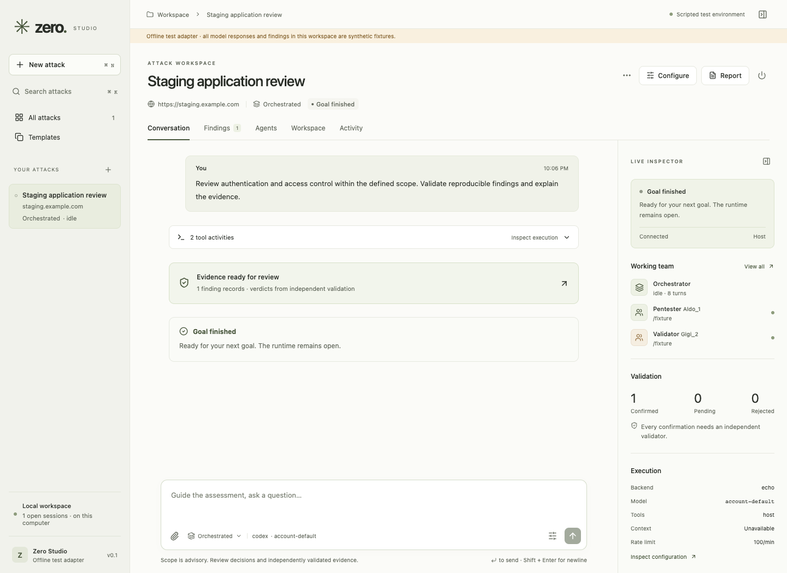
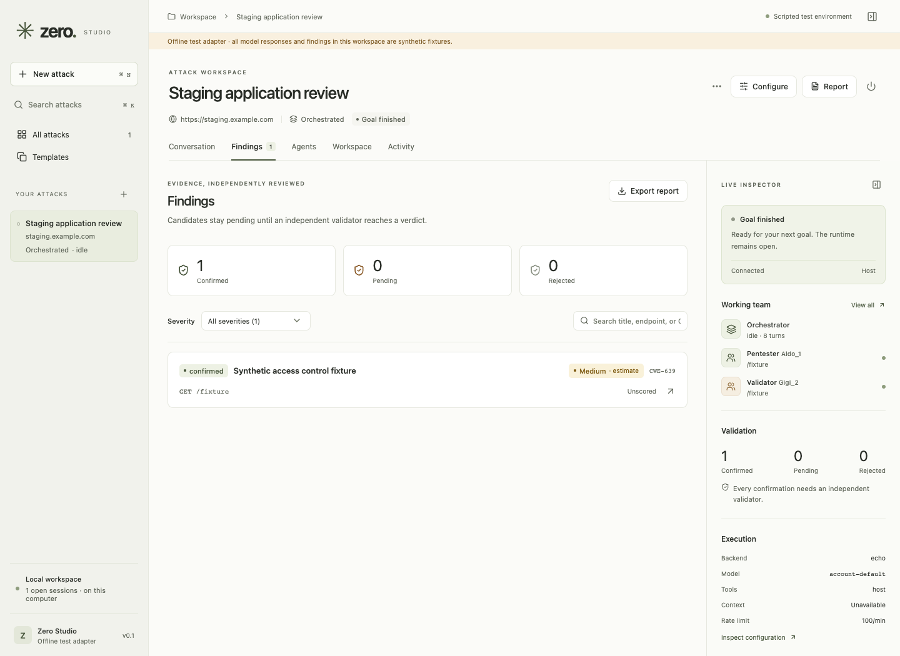

<div align="center">

<pre>
 ███████╗███████╗██████╗  ██████╗
 ╚══███╔╝██╔════╝██╔══██╗██╔═══██╗
   ███╔╝ █████╗  ██████╔╝██║   ██║
  ███╔╝  ██╔══╝  ██╔══██╗██║   ██║
 ███████╗███████╗██║  ██║╚██████╔╝
 ╚══════╝╚══════╝╚═╝  ╚═╝ ╚═════╝
</pre>

<p><strong>An autonomous, multi-agent system for web application pentesting and bug-bounty work.</strong></p>

<p>Parallel testing · independent validation · sandboxed tools · auditable reports</p>

</div>

`zero` investigates web applications through **Zero Studio**, a local browser interface for
creating attacks, coordinating agents, reviewing evidence, and exporting reports.



*Screenshots show the actual interface with synthetic offline demonstration data.*

> [!CAUTION]
> Use `zero` only on systems you own or have explicit permission to test.

## Why zero?

- **One workspace per attack** — keep scope, goals, conversations, configuration, and evidence
  together. Switch between attacks while their assessments continue.
- **Parallel investigation** — an orchestrator dispatches focused pentesters; Swarm mode adds
  collaborating peer orchestrators with shared work and evidence.
- **Independent validation** — separate validators confirm or reject candidate findings.
- **Visible progress** — inspect active agents, tools, memory, todos, and pending decisions.
- **Useful results** — filter findings by verdict and severity, inspect reproduction steps,
  copy a finding to the clipboard, or export the report.
- **Your model backend** — use an authenticated Codex or Claude CLI, with configuration per attack.
- **Sandboxed tools** — Docker runs security tools while the agent loops run on the host.

Prefer the terminal? See the separate [command-line guide](CLI.md).

## Quick start

### Prerequisites

- Python 3.11 or newer and [`uv`](https://docs.astral.sh/uv/).
- Node.js 22.12 or newer, including npm.
- An authenticated `codex` or `claude` CLI available on `PATH`. Studio uses it to run the agents.
- Docker, running locally, for the recommended tool sandbox. Allow roughly 6 GB for the image.

### Install and open Studio

Run these commands from your checkout:

```bash
git clone https://github.com/dave90/zero-day.git
cd zero-day
uv sync --project ui/server
npm --prefix ui/web ci
docker build -t zero-sandbox:latest -f docker/Dockerfile .
./ui/dev.sh
```

Open **http://127.0.0.1:4319** and keep the launch terminal running. The local service listens on
port 4318 and the frontend on 4319. Opening Studio does not start an assessment.

For serving a built UI from a single port or selecting another data directory, see the
[Studio setup guide](ui/README.md#install-and-launch).

## Create your first attack

### 1. Add the target, scope, and goal

Click **New attack** in the sidebar. Choose **Blank assessment** under **Start from**, then fill in:

| Field | Example |
| --- | --- |
| Attack name | Staging application review |
| Target / start URL | `https://staging.example.com` — replace this with your authorized target |
| Engagement context | Allowed hosts, routes, test accounts, exclusions, and testing constraints |
| First goal | Review authentication and access control within the defined scope. Validate reproducible findings and explain the evidence. |

Write the engagement context directly or use **Import file** to load an existing `pentest.md`.
For example:

```markdown
# Staging application assessment

## Scope
- Only https://staging.example.com and its same-origin APIs.
- Test accounts and synthetic records only.
- Exclude production, denial-of-service, and destructive actions.

## Credentials
- Add dedicated test accounts here when required.

## Goal
Review authentication and access-control boundaries.
```

Attach source snapshots, request samples, or Burp exports when useful. Imports are limited to
1 MB per file. Select a working style and click **Create attack**.


Studio creates a dedicated workspace and saves the first goal in the conversation composer.
Creating the attack saves its setup; sending the goal starts the assessment.

### 2. Configure and start the assessment

Open **Configure** to choose the backend, model, working style, budgets, sandbox, rate limits,
and approval settings.

| Working style | What it does |
| --- | --- |
| **Orchestrated** | An orchestrator investigates and dispatches pentesters and validators. The default starting point. |
| **Swarm** | Several peer orchestrators coordinate work, each with its own pentesters and validators. |
| **Ralph** | Review a proposed plan, then run bounded orchestrated passes with durable progress. |
| **Single agent** | One pentester investigates with background validators. |
| **MCP delegated** | Claude Code manages the agent loop through MCP. Requires the Claude backend. |

With Codex, **Model & sessions → Model** offers a searchable model list discovered from the
installed CLI. An explicit selection applies to that Zero runtime and its agents. Configuration
saved during an open runtime applies to the next runtime; end the current session to switch.

Save the configuration, return to **Conversation**, and send the first goal with **Enter** or the
send arrow. Studio checks backend authentication and sandbox readiness before starting.
Review [Agents & budgets and Approvals](#important-configuration) below before starting a run.

Tool approvals, questions, and Ralph plan checkpoints appear in the conversation. Review each
request and use its displayed controls to allow, deny, answer, or revise the plan.

### 3. Follow progress and review results

- **Conversation** shows messages, tool activity, operator decisions, and assessment progress.
  **Goal finished** means Zero is ready for another goal; the runtime remains open. **Background
  work running** means agents or tools are still active. Last activity shows how recently the
  runtime reported an event.
- **Agents** shows each actor's objective, tools, memory, and todos. In Swarm mode, expand or
  collapse a peer to inspect its pentesters and validators. Memory and todos open inside the
  selected agent's tabs.
- **Findings** shows evidence, independent validation, severity, and reproduction steps. Click a
  confirmed/pending/rejected summary card to filter by verdict; click it again to clear that
  filter. Combine it with **Severity** and search. Agent severity hints are marked **estimate**;
  missing validator scores remain **Unscored**.
- **Workspace** contains scope, imported files, reports, and saved run snapshots.
- **Activity** contains the audit trail, reasoning, model I/O, and Swarm records.



Open a finding and choose **Copy to clipboard** or **Export finding**. Use **Export report** on
the Findings page, or **Report** in the attack header, when a report is available.

To continue, send another goal in the same conversation. To stop the runtime and its background
work, use **End runtime session** in the attack header; conversation and evidence are preserved.

## Important configuration

Open **Configure** on an attack to review these settings. The defaults below apply to new blank
attacks and CLI runs. Existing attacks and templates keep their saved values; update them in
Configure when you want different budgets. An open runtime keeps its configuration until it ends.

### Agents & budgets

In **Configure → Agents & budgets**, the three investigation turn limits default to **50**:

| Setting | Default | What it controls |
| --- | --- | --- |
| **Max turns** | **50** | Main agent's turn limit for a goal; each Swarm peer has its own budget. |
| **Pentester max turns** | **50** | Investigation steps for each dispatched pentester. |
| **Validator max turns** | **50** | Investigation steps for each independent validator. |
| **Max subagents** | `10` | Pentesters and validators allowed to run concurrently per peer. |
| **Max total subagents** | `0` (unlimited) | Total child dispatches per peer; set a positive value to cap dispatches. |
| **Subagent deadline** | `1200` seconds | Elapsed-time limit per subagent, checked between turns. |
| **LLM timeout** | `900` seconds | Maximum wait for one model call, shared by main agents and subagents. |

Turn limits are independent: changing Max turns does not change the pentester or validator
budget. Agents can finish before reaching their limit. Deadlines are checked between turns and
do not interrupt an in-flight approval wait or tool call; model and tool timeouts are separate.
**Validator Claude max turns** controls Claude's internal per-call behavior, separately from the
50-step validator investigation budget.

In Swarm mode, concurrency and total-child caps apply **per peer**. For example, four peers with
Max total subagents set to 20 can dispatch up to 80 children in total. These settings bound work,
not a monetary or token allowance.

### Approvals

In **Configure → Approvals**, automatic approvals are disabled by default. Calls that require
approval show a decision card in the conversation.

| Setting | Default | Effect when enabled |
| --- | --- | --- |
| **Auto approve** | No risk classes selected | Automatically approve the selected `safe`, `active`, or `exploit` classes. Exploit also requires **I understand**. |
| **Yolo** | Off | Automatically approve `safe` and `active` calls. Exploit and destructive calls are not covered. |
| **I understand** | Off | Acknowledgement required together with `exploit` in Auto approve. It does not grant approvals by itself. |
| **Allow host exec** | Off | Permit code/binary tools running on the host to use the configured approval policy. It does not approve calls by itself. |

For each approval card, choose **Allow once** or **Deny**. Eligible tools also offer **Allow tool
this session**; this grant lasts for the current runtime. Destructive actions always require a
decision. Host-executed code/binary tools still prompt unless Allow host exec is enabled, even
when a risk class or session grant would otherwise approve them. Approval settings do not remove
Ralph plan checkpoints or agent questions.

## Reuse and organize attacks

Open an attack's **⋯ menu → Create template** to save its configuration and first goal. Optionally
include `pentest.md`, including any credentials it contains. **Save & create attack** immediately
opens a fresh assessment; saved templates are also available under **New attack → Start from**.
New attacks start without the source's messages, findings, uploads, agents, or run history.

Use **Templates** in the sidebar to create attacks from saved setups or delete a template.
Deleting a template preserves attacks already created from it.

An attack's **⋯ menu** also offers **Archive** and **Delete attack**. Archive keeps its evidence;
deleting an attack permanently removes its workspace and conversation after confirmation.

## Where your data is stored

Studio stores its workspace locally under `ui/.local/` by default:

```text
ui/.local/
├── workspace.sqlite3                     attacks, templates, drafts, sessions, and events
└── engagements/<attack-id>/
    ├── work/
    │   ├── pentest.md                    engagement context
    │   ├── zero_files/                   imported files (default files root)
    │   └── .pentest/                     findings, reports, audit, memory, todos, and model logs
    └── history/<session-id>/             sealed session evidence and goal snapshots
```

Ralph also records planning and progress in `.ralph/` and `.ralph_logs/` within the attack's
working directory. These directories and model traces can contain credentials and full prompts;
handle them according to your engagement's data-handling rules.

Scope context guides the agents; it is not a network firewall. If sandbox startup fails after
preflight, Zero can fall back to host execution and displays that state. Review tool approvals
and the execution location shown by Studio. Live assessments consume the selected backend's
allowance; use turn budgets and total subagent caps to bound work.

## Documentation

- [Command-line guide](CLI.md) — terminal setup, flags, scope files, approvals, Swarm, and Ralph.
- [Studio guide](ui/README.md) — configuration, storage, launch options, and UI verification.
- [Architecture](architecture.md) — shared runtime, orchestration, tools, and ownership.
- [BountyBench integration](benchmarks/bountybench/README.md) — external capability evaluation.

## Development

```bash
uv sync
uv run pytest tests/unit -q  # offline core tests
uv run pytest -q             # core + Docker tests; live model tests are excluded
uv run ruff check .
uv build
```

Run UI checks separately using the [Studio test commands](ui/README.md#tests). Docker tests skip
with guidance when the image is unavailable. Live and regression suites spend model tokens and
require explicit opt-in; see [regression tests](tests/regression/) before running them.

## License

Licensed under the [GNU General Public License v3.0](LICENSE).
